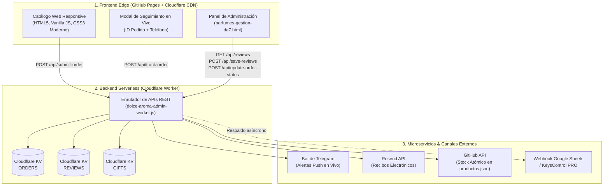

# 💎 Dolce 7 Aroma — Manual General del Ecosistema, Beneficios y Ventajas Competitivas

> **Documento Maestro de Arquitectura, Operaciones y Argumentario Comercial**  
> **Versión:** 2.6.0 | **Ecosistema:** Dolce 7 Aroma Retail  
> **Autor:** Equipo de Ingeniería y Producto | **Última actualización:** Noviembre 2026

---

## 1. Resumen Ejecutivo y Propuesta de Valor

**Dolce 7 Aroma** es una plataforma de comercio electrónico de fragancias de alta gama diseñada bajo el paradigma **Headless Edge Architecture**. A diferencia de las tiendas convencionales montadas sobre WordPress o Shopify, Dolce 7 Aroma separa por completo la experiencia visual del cliente (Frontend) del motor de procesamiento y base de datos (Backend Serverless).

El resultado es un sistema que:
1. **Carga en menos de 0.8 segundos** en cualquier dispositivo móvil o conexión 4G/5G en Perú.
2. **Opera a costo de infraestructura \$0 USD** en escalas de micro y pequeña empresa, utilizando infraestructura global de Google Cloudflare y GitHub.
3. **Mantiene soberanía absoluta sobre sus datos**: los pedidos, clientes e inventario no están cautivos en plataformas de suscripción mensual ni dependen de servidores vulnerables a virus o caídas.
4. **Ofrece redundancia cruzada de datos**: los pedidos se guardan en tiempo real en **Cloudflare KV** y se respaldan asíncronamente en **Google Sheets / KeysControl PRO**.

---

## 2. Arquitectura Tecnológica y Soberanía de Datos



### 2.1. El Principio de Autonomía de Datos (Soberanía Web)
- **Base de Datos Principal (Nativa):** Cloudflare KV. Almacena las entidades `order:ORD-XXXX`, `gift:D7A-XXXX` y `config:reviews` con replicación en más de 300 centros de datos mundiales.
- **Independencia Operativa:** La web **jamás se detiene** si un servicio externo (como Google Sheets o el ERP) se satura o agota sus cuotas de API. El cliente siempre puede ver el catálogo, armar su carrito y comprar.
- **Redundancia Cruzada (Zero Data Loss):** Si la base de datos de Cloudflare sufriera un incidente catastrófico, la información completa de cada venta existe duplicada en Google Sheets. Si Google Sheets cambia de políticas, Cloudflare mantiene la operación intacta.

---

## 3. Catálogo Completo de Beneficios y Nuevas Funcionalidades

### 3.1. Rastreo de Pedidos en Tiempo Real para el Cliente (Tracking Sin Fricción)
- **Problema que resuelve:** Reduce drásticamente los mensajes de clientes preguntando por WhatsApp: *"¿Ya enviaron mi perfume?", "¿Por dónde viene mi pedido?"*.
- **Cómo opera:**
  - El cliente ingresa a la tienda y pulsa en el menú **"Seguimiento"**.
  - No requiere crear usuario ni contraseña (cero fricción): solo ingresa su **Número de Pedido** (ej. `ORD-17311...`) y su **Teléfono registrado** (últimos 9 dígitos).
  - El sistema consulta el endpoint seguro `POST /api/track-order`.
  - Despliega una tarjeta visual interactiva con el estado en vivo:
    - 🟡 **Nuevo:** Pedido recibido, pendiente de confirmación de pago.
    - 🔵 **Pagado:** Pago verificado, perfume en preparación y empaque.
    - 🟣 **En Camino:** Paquete despachado con su **Número de Guía de Courier** y agencia (Olva Courier, Shalom o motorizado local).
    - 🟢 **Entregado:** Pedido completado exitosamente.
    - 🔴 **Cancelado:** Pedido anulado.

### 3.2. Deducción Atómica de Stock Blindada contra Carritos Abandonados
- **Problema que resuelve:** En tiendas mal diseñadas, cuando un cliente agrega un producto al carrito o inicia un checkout y luego no paga, el stock se bloquea y se pierde la venta con clientes reales.
- **Regla de Oro de Dolce 7 Aroma:**
  - Al generar el pedido (`nuevo`), el stock **NO se descuenta**.
  - La deducción de unidades se ejecuta **única y exclusivamente** cuando el estado cambia a `pagado`.
  - El Worker realiza una transacción atómica vía API de GitHub: descarga `data/productos.json`, resta las unidades de la presentación exacta (`10ml`, `50ml`, `110ml`), valida que el saldo no sea negativo y confirma el commit con SHA verificado.

### 3.3. Captura de Correo Electrónico y Recibo Digital Automático (Resend API)
- **Problema que resuelve:** Profesionaliza la imagen de la marca y deja constancia formal de la compra sin intervención manual.
- **Cómo opera:**
  - El checkout valida y captura obligatoriamente el correo del cliente (`orderForm.email`).
  - Al confirmarse el pago (`pagado`), el Worker dispara una plantilla HTML de alta conversión mediante la API de **Resend**.
  - El cliente recibe en su bandeja de entrada el comprobante oficial con número de pedido, resumen de fragancias, mililitros, total pagado y dirección de envío.

### 3.4. Sistema de Reseñas Persistente en la Nube (Cloudflare KV)
- **Problema que resuelve:** La prueba social (testimonios y estrellas de satisfacción) necesitaba anteriormente hacer commits manuales en el repositorio para actualizarse.
- **Cómo opera:**
  - Desde el panel de administración (`perfumes-gestion-da7.html`), el administrador puede añadir, editar o moderar reseñas con un clic.
  - Se guardan en milisegundos en la clave `config:reviews` de Cloudflare KV mediante `POST /api/save-reviews`.
  - El storefront las carga en segundo plano (`GET /api/reviews`) y las almacena en caché local del navegador, garantizando que los nuevos clientes siempre vean testimonios frescos.

### 3.5. Recuperación Inteligente de Pedidos Pendientes (Estrategia Comercial)
- **Oportunidad de Venta:** Cuando un cliente completa el formulario pero no sube la captura de Yape/Plin, el pedido se almacena con estado `nuevo`.
- **Protocolo de Recuperación:**
  - Los datos del cliente (nombre, teléfono, fragancias deseadas y total) quedan registrados.
  - Permite al equipo comercial iniciar una secuencia de seguimiento por WhatsApp durante **7 días**:
    - *Día 1:* Recordatorio amigable de fragancia reservada y enlace de pago.
    - *Día 3:* Pregunta de asesoría sobre notas olfativas o dudas con el método de pago.
    - *Día 7:* Última llamada antes de liberar la reserva. Si no se concreta el pago, el pedido se pasa a `cancelado`.

### 3.6. Conector REST Universal para ERP (KeysControl PRO Ready)
- **Problema que resuelve:** Permite conectar torres de control o CRMs empresariales externos sin reescribir la tienda.
- **Endpoint:** `POST /api/external/update-status`
- **Seguridad:** Protegido mediante token `KEYSCONTROL_API_KEY`.
- **Capacidad:** Permite que KeysControl PRO actualice el estado (`nuevo` -> `en_camino`) y asigne la guía del courier (`guia_courier`) directamente desde la hoja de control contable del ERP.

---

## 4. Matriz Comparativa Frente a Frente (Argumentario Comercial)

Esta tabla resume por qué la arquitectura de **Dolce 7 Aroma** es superior frente a las plataformas de comercio tradicionales. Puede utilizarse directamente como material de ventas o pitch para clientes e inversionistas:

| Criterio | Dolce 7 Aroma (Headless Edge) | Shopify | WooCommerce (WordPress) | Tiendas SaaS Cerradas |
|---|---|---|---|---|
| **Costo Fijo Mensual** | **\$0.00 USD / mes** (Tiers gratuitos globales) | \$39 a \$105 USD / mes + apps | \$15 a \$40 USD / mes (Hosting + SSL) | \$25 a \$80 USD / mes |
| **Comisión por Venta** | **0% de comisión** propia | 2% si no usas Shopify Payments | 0% propio (pero pagas plugins caros) | 1% a 3% por transacción |
| **Velocidad de Carga (LCP)** | **< 0.8 segundos** (Ultra rápida) | 2.5 a 4.0 segundos (código inflado) | 3.0 a 6.0 segundos (plugins pesados) | 2.0 a 3.5 segundos |
| **Mantenimiento y Actualizaciones** | **Cero mantenimiento:** sin plugins que se desactualicen | Mantenido por la plataforma | Alto riesgo: plugins rompen el sitio con cada actualización | Cerrado al proveedor |
| **Seguridad y Vulnerabilidades** | **Máxima (Inmune a SQL Injection):** No hay base de datos expuesta | Alta | Crítica: blanco constante de bots y malware en PHP | Media |
| **Soberanía de Datos** | **100% de la empresa** (Cloudflare KV + Google Sheets) | Datos retenidos en el ecosistema de Shopify | Local en hosting MySQL | Propiedad de la plataforma |
| **Rastreo para el Cliente** | **Nativo y sin contraseñas** (ID + WhatsApp) | Requiere crear cuenta o pagar app extra | Requiere plugin de pago (\$49/año) | Limitado o inexistente |
| **Deducción de Inventario** | **Atómica al confirmar pago** (No traba stock) | Bloquea stock o requiere reglas complejas | Se bloquea por pedidos pendientes | Rígido |
| **Control Multicanal** | **Integrado nativamente** con KeysControl PRO | Requiere integraciones de terceros | Requiere Zapier o Make (costo extra) | No integrable |

---

## 5. Protocolos y Flujos Operativos Paso a Paso

### 5.1. Flujo del Comprador (Experiencia de Usuario)
```
1. Cliente navega el catálogo -> Selecciona fragancia y tamaño (10ml, 50ml, 110ml)
   └── Agrega al carrito -> Opcional: añade Frasco Premium o Caja de Regalo.
2. Checkout transparente:
   └── Nombre, Teléfono/WhatsApp, Correo Electrónico (para recibo).
   └── Selección de Distrito (cálculo automático de envío gratis o tarifa plana).
   └── Selección de Pago: Yape / Plin / Tarjeta / Efectivo.
3. Envío del Pedido:
   └── Se genera el código único (ej. ORD-1731198540).
   └── Se guarda instantáneamente en Cloudflare KV (order:ORD-...).
   └── Se dispara alerta push al Telegram del Administrador.
   └── Se sincroniza el respaldo en Google Sheets / KeysControl PRO.
   └── Redirección automática a WhatsApp oficial con mensaje pre-armado.
```

### 5.2. Flujo del Administrador (Gestión del Pedido)
```
1. El Administrador recibe la notificación en Telegram o revisa perfumes-gestion-da7.html.
2. Verifica el abono bancario en su app de Yape/Plin/Banco.
3. En perfumes-gestion-da7.html:
   └── Cambia el estado del pedido a "pagado":
       ├── El Worker descuenta automáticamente las unidades en data/productos.json.
       └── Resend envía el recibo formal al correo del cliente.
4. Cuando el pedido sale a despacho:
   └── Cambia el estado a "en_camino" e ingresa el número de Guía del Courier.
5. El cliente consulta en el menú "Seguimiento" de la web y ve su paquete en ruta con su guía.
```

---

## 6. Estructura de Datos Homologada (Estándar 19 Columnas)

Todos los componentes del ecosistema (Cloudflare KV, Webhooks, Google Sheets y KeysControl PRO) intercambian datos bajo la misma matriz de 19 campos:

| N° | Clave Técnica | Tipo | Ejemplo Real |
|:--:|---|---|---|
| 1 | `order_id` | String | `ORD-1731198540` |
| 2 | `empresa_origen` | String | `DOLCE7AROMA` |
| 3 | `fecha_hora` | ISO String | `2026-11-10T03:15:00.000Z` |
| 4 | `cliente_nombre` | String | `Carlos Mendoza` |
| 5 | `cliente_telefono` | String | `987654321` |
| 6 | `cliente_email` | String | `carlos.mendoza@gmail.com` |
| 7 | `distrito` | String | `San Martín de Porres` |
| 8 | `direccion` | String | `Av. Perú 2450` |
| 9 | `referencia` | String | `Frente al parque Virgen del Carmen` |
| 10 | `subtotal` | Float | `55.00` |
| 11 | `envio` | Float | `0.00` |
| 12 | `total` | Float | `55.00` |
| 13 | `metodo_pago` | String | `yape` |
| 14 | `estado` | String | `pagado` |
| 15 | `guia_courier` | String | `OLVA-748923` |
| 16 | `items_resumen` | String | `1x Sauvage Dior 50ml` |
| 17 | `items_detalle` | JSON String | `[{"id":"p1","nombre":"Sauvage","size":"50ml","qty":1,"price":55}]` |
| 18 | `notas` | String | `Entregar después de las 4 PM` |
| 19 | `actualizado_en` | ISO String | `2026-11-10T03:20:00.000Z` |

---

## 7. Próximos Pasos en el Ecosistema Omnicanal

Con la culminación del **Hito 1 (Soberanía Web & Backend Edge)**, la tienda Dolce 7 Aroma es 100% autónoma y de nivel empresarial. La siguiente fase de integración comprende:

- **Hito 2 · Adaptación de KeysControl PRO:**
  Configuración de la torre de control en Google Apps Script para ingerir pedidos vía Webhook, vincular clientes a su LTV histórico y permitir la actualización remota de estados hacia Dolce 7 Aroma.
- **Hito 3 · Gestión Multi-Empresa:**
  Gobernanza centralizada para operar simultáneamente `RETAIL / DOLCE7AROMA` (Perfumes) y `RETAIL / ROPAS D7A` (Prendas de vestir) bajo la misma consola administrativa.
- **Hito 4 · Despliegue PWA Standalone:**
  Instalación como aplicación de escritorio y móvil sin barras de navegador, con soporte offline y dominio personalizado.
