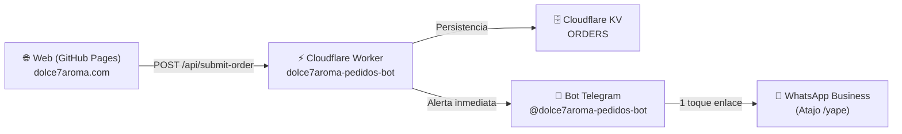

# 🏛️ MANUAL MAESTRO DE ARQUITECTURA, SISTEMAS Y OPERACIÓN
**Dolce 7 Aroma** — Actualizado al 19 de Noviembre de 2026

---

## 1. Identidad de Marca y Canales
* **Marca Oficial:** **Dolce 7 Aroma** (aplicada al 100% en web, redes sociales y comunicaciones).
* **Dominio Web:** `https://dolce7aroma.com` (alojado en GitHub Pages con certificado SSL).
* **Punto de Retiro Físico:** Jr. Callao 482-A, San Martín de Porres (Bazar Sport Shirley).
* **Estrategia de Packaging:** Se consumen los stickers físicos existentes de *Dolce Aroma* hasta agotar stock; a partir de allí, el packaging migra al diseño exclusivo de *Dolce 7 Aroma* con el "7 misterioso fino".

---

## 2. Arquitectura de Sistemas y Componentes Activos

### Componente 1: Tienda Web (`assets/shop.js` + `catalogo.html` + `index.html`)
* **Modelo de Checkout:** Venta Asistida Concierge (Sin exposición de cuentas bancarias en la web).
* **Beneficio Regalo:** Switch de cortesía `[ ] 🎁 ¿Es para regalo? (Incluye Bolsa de Regalo GRATIS)`.
* **Mensaje de Confirmación al Cliente:**
  > *"Un asesor de Dolce 7 Aroma se comunicará contigo vía WhatsApp al [teléfono] para coordinar la entrega y facilitar los medios de pago oficiales."*
* **Resiliencia:** Si la red o el Worker fallan, genera un código local `W-XXXXX` y deriva a WhatsApp para asegurar el 100% de las ventas.

### Componente 2: Cloudflare Worker (`worker/dolce-aroma-admin-worker.js`)
* **Nombre:** `dolce7aroma-pedidos-bot`
* **Base de datos:** Cloudflare KV Namespace `ORDERS` (ID: `4618ca47d7094c31acf4b3219c25d7ed`).
* **Endpoints Activos:**
  * `POST /api/submit-order`: Valida precios del catálogo, guarda el pedido en KV y notifica a Telegram.
  * `POST /api/list-orders`: Consulta pedidos para el panel de administración.
  * `POST /api/update-order-status`: Actualiza estado (nuevo, pagado, cancelado).

### Componente 3: Bot de Telegram (`@dolce7aroma-pedidos-bot`)
* **Seguridad:** Restringido exclusivamente al Chat ID del administrador (`8616800327`).
* **Comandos Operativos Activos:**
  * `/resumen`: Balance del día, pedidos pendientes y balance de 7 días.
  * `/pedidos`: Lista los pedidos pendientes con enlaces directos para chatear con cada cliente.
  * `/pagado [ID]`: Marca un pedido como pagado y descuenta automáticamente el stock en el catálogo.
  * `/cancelar [ID]`: Anula un pedido no concretado.
  * `/limpiar_pruebas`: Cambia en masa todas las pruebas pasadas a `cancelado` para resetear el contador a 0.
  * `/top`: Ranking de los 5 perfumes más vendidos.
  * `/campana`: Planificador de campañas comerciales con IA.

---

## 3. Estado de Pasarelas y Medios de Pago

| Método de Pago | Estado | Modo de Operación | Comisión |
| :--- | :---: | :--- | :---: |
| **Yape / Plin (Concierge)** | **ACTIVO 100%** | Privado vía WhatsApp Business con atajo `/yape`. Cero datos expuestos en la web. | **0%** |
| **Culqi (Tarjetas)** | **EN PAUSA** | El código base está listo en el Worker, pero desactivado en la web hasta formalizar el RUC. | 3.44% + $0.20 |

---

## 4. Guía de Tokens, Permisos y Secretos

> [!NOTE]
> **Aclaración sobre el correo de permiso caducado:**
> **No fue de Culqi.** Fue un correo de **GitHub** avisando que el Personal Access Token (`GITHUB_TOKEN`) caducó.

### ¿Por qué la tienda y el bot siguen funcionando aunque ese token haya caducado?
* La web, la base de datos KV y el bot de Telegram viven en **Cloudflare** y son **independientes de GitHub**. 
* El `GITHUB_TOKEN` solo se utiliza cuando tú entras al panel web de administración (`perfumes-gestion-da7.html`) y haces clic en "Guardar cambios en catálogo" para que el Worker pueda escribir en el repositorio de GitHub.
* **¿Tendrás que renovarlo siempre?:** **NO.** Si creas el token en GitHub con la casilla de expiración en **"No expiration"** (sin fecha de vencimiento), dura para siempre y nunca más te llegará ese correo.

---

## 5. Protocolo de Operación de una Venta

1. **Cliente:** Llena su pedido en la web y ve la confirmación.
2. **Worker:** Guarda el pedido en KV y te envía una alerta a Telegram con el botón azul `[👉 ABRIR WHATSAPP Y ENVIARLE EL YAPE]`.
3. **Tú:** Tocas el botón, se abre WhatsApp Business, digitas `/yape` y envías tus datos oficiales de forma privada.
4. **Cliente:** Te envía la captura del pago por Yape.
5. **Cierre:** Vuelves a Telegram y escribes `/pagado [ID]`. Tu stock web se actualiza automáticamente.
