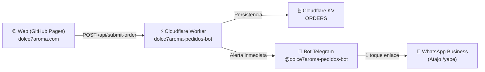
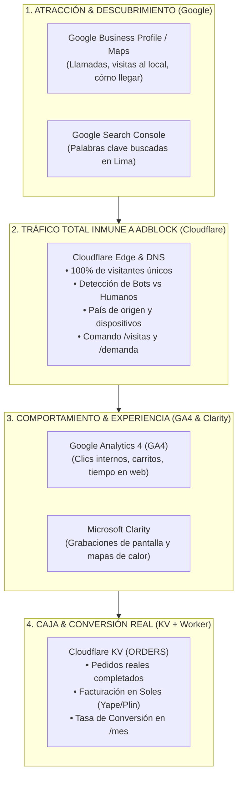

# 🏛️ MANUAL MAESTRO DE ARQUITECTURA, SISTEMAS Y OPERACIÓN
**Dolce 7 Aroma** — Actualizado al 19 de Noviembre de 2026

---

## 1. Identidad de Marca y Canales
* **Marca Oficial:** **Dolce 7 Aroma** (aplicada al 100% en web, redes sociales y comunicaciones).
* **Dominio Web:** `https://dolce7aroma.com` (alojado en GitHub Pages con certificado SSL).
* **Punto de Retiro Físico:** Jr. Callao 482-A, San Martín de Porres (Bazar Sport Shirley).
* **Estrategia de Packaging:** Se consumen los stickers físicos existentes de *Dolce Aroma* hasta agotar stock; a partir de allí, el packaging migra al diseño exclusivo de *Dolce 7 Aroma* con el "7 misterioso fino".

---

## 2. Arquitectura de Sistemas y Componentes Activos

### Componente 1: Tienda Web (`assets/shop.js` + `catalogo.html` + `index.html`)
* **Modelo de Checkout:** Venta Asistida Concierge (Sin exposición de cuentas bancarias en la web).
* **Beneficio Regalo:** Switch de cortesía `[ ] 🎁 ¿Es para regalo? (Incluye Bolsa de Regalo GRATIS)`.
* **Mensaje de Confirmación al Cliente:**
  > *"Un asesor de Dolce 7 Aroma se comunicará contigo vía WhatsApp al [teléfono] para coordinar la entrega y facilitar los medios de pago oficiales."*
* **Resiliencia:** Si la red o el Worker fallan, genera un código local `W-XXXXX` y deriva a WhatsApp para asegurar el 100% de las ventas.

### Componente 2: Cloudflare Worker (`worker/dolce-aroma-admin-worker.js`)
* **Nombre:** `dolce7aroma-pedidos-bot`
* **Base de datos:** Cloudflare KV Namespace `ORDERS` (ID: `4618ca47d7094c31acf4b3219c25d7ed`).
* **Endpoints Activos:**
  * `POST /api/submit-order`: Valida precios del catálogo, guarda el pedido en KV y notifica a Telegram.
  * `POST /api/list-orders`: Consulta pedidos para el panel de administración.
  * `POST /api/update-order-status`: Actualiza estado (nuevo, pagado, cancelado).

### Componente 3: Bot de Telegram (`@dolce7aroma-pedidos-bot`)
* **Seguridad & Roles:**
  * **Rol 2 (Dueño / Administrador General):** Tu cuenta personal (Chat ID: `8616800327`), con acceso al 100% de los módulos financieros, estratégicos y operativos.
  * **Rol 1 (Operativo / Mostrador):** *Por definir* (previsto para colaboradores en tienda física o atención de mostrador; restringido solo a consulta de stock y validación de entregas, sin acceso a finanzas).

* **Estructura Oficial por Categorías Padre (con Fechas y Leyendas de Uso):**
  1. **📦 PEDIDOS & CAJA (Operación Diaria):**
     * `/resumen` (o `/hoy`) — Caja del día y balance en soles *(📅 Cada noche al cerrar)*.
     * `/pedidos` — Pedidos pendientes con botón directo a WhatsApp *(📅 En tiempo real)*.
     * `/pagado [ID]` — Confirmar cobro y descontar stock *(📅 Al verificar comprobante Yape)*.
     * `/cancelar [ID]` — Cancelar pedido no concretado.
  2. **🏷️ MOSTRADOR & CONSULTA RÁPIDA:**
     * `/precios [aroma]` — Stock y precios al instante *(📅 Con cliente al frente en Bazar Shirley)*.
  3. **📊 ESTRATEGIA & CRECIMIENTO (Rutina de Negocio):**
     * `/semana` — Rendimiento semanal con gráfico de barras *(📅 Lunes 8:00 AM)*.
     * `/cro` — Embudo de conversión y abandonos *(📅 Día 16 de cada mes)*.
     * `/mes` — Facturación mensual, tráfico web de Cloudflare, tasa de conversión y gráfico de dona *(📅 Día 1 de cada mes a las 6:00 AM)*.
     * `/top` — Ranking de los 5 perfumes más vendidos en la web.
     * `/campana` — Reloj comercial y planificador de fechas *(📅 Pre-campañas y quincenas)*.
  4. **🌐 TRÁFICO WEB & DEMANDA (Auditoría de Clientes):**
     * `/visitas` — Tráfico real en Cloudflare Analytics *(📅 Diario o interdiario para ver volumen)*.
     * `/demanda` — Radiografía de visitantes reales, proporción mujer/hombre, aromas buscados y recomendación *(📅 Viernes y sábados para armar ofertas del fin de semana)*.
     * `/seo` — Indexación en Google y distritos más activos *(📅 Quincenal o mensual)*.
  5. **⚙️ SISTEMA & DEV (Comandos Ocultos de Mantenimiento):** `/sheets sync`, `/probar_cron`, `/limpiar_pruebas`.

---

## 3. Estado de Pasarelas y Medios de Pago

| Método de Pago | Estado | Modo de Operación | Comisión |
| :--- | :---: | :--- | :---: |
| **Yape / Plin (Concierge)** | **ACTIVO 100%** | Privado vía WhatsApp Business con atajo `/yape`. Cero datos expuestos en la web. | **0%** |
| **Culqi (Tarjetas)** | **EN PAUSA** | El código base está listo en el Worker, pero desactivado en la web hasta formalizar el RUC. | 3.44% + $0.20 |

---

## 4. Guía de Tokens, Permisos y Secretos

> [!NOTE]
> **Aclaración sobre el correo de permiso caducado:**
> **No fue de Culqi.** Fue un correo de **GitHub** avisando que el Personal Access Token (`GITHUB_TOKEN`) caducó.

### Secretos y Variables del Ecosistema Cloudflare:
* **`CF_ZONE_ID`** (`ad33e3a6436f0874c04c5c8dbcf966a4`): Variable pública en `wrangler.toml` que identifica el dominio `dolce7aroma.com`.
* **`CF_API_TOKEN`** (Secreto cifrado en Worker): Token de Cloudflare con permisos de `Analytics: Read` y `Workers: Edit` para alimentar el comando `/visitas` y permitir despliegues de infraestructura.
* **`TELEGRAM_BOT_TOKEN`** & **`TELEGRAM_CHAT_ID`** (`8616800327`): Control y canal seguro del bot.
* **`ORDERS`** (KV: `4618ca47d7094c31acf4b3219c25d7ed`): Base de datos de pedidos en tiempo real.

### ¿Por qué la tienda y el bot siguen funcionando aunque ese token haya caducado?
* La web, la base de datos KV y el bot de Telegram viven en **Cloudflare** y son **independientes de GitHub**. 
* El `GITHUB_TOKEN` solo se utiliza cuando tú entras al panel web de administración (`perfumes-gestion-da7.html`) y haces clic en "Guardar cambios en catálogo" para que el Worker pueda escribir en el repositorio de GitHub.
* **¿Tendrás que renovarlo siempre?:** **NO.** Si creas el token en GitHub con la casilla de expiración en **"No expiration"** (sin fecha de vencimiento), dura para siempre y nunca más te llegará ese correo.

---

## 5. Protocolo de Operación de una Venta

1. **Cliente:** Llena su pedido en la web y ve la confirmación.
2. **Worker:** Guarda el pedido en KV y te envía una alerta a Telegram con el botón azul `[👉 ABRIR WHATSAPP Y ENVIARLE EL YAPE]`.
3. **Tú:** Tocas el botón, se abre WhatsApp Business, digitas `/yape` y envías tus datos oficiales de forma privada.
4. **Cliente:** Te envía la captura del pago por Yape.
5. **Cierre:** Vuelves a Telegram y escribes `/pagado [ID]`. Tu stock web se actualiza automáticamente.

---

## 6. Matriz de Responsabilidades de Medición: ¿Quién hace qué?

Para evitar confusiones y solapamientos, cada herramienta del ecosistema Dolce 7 Aroma tiene una responsabilidad única y complementaria:

### Tabla Comparativa de Herramientas:

| Herramienta | Rol Principal | ¿Qué mide exactamente? | ¿Por qué es necesaria? |
| :--- | :--- | :--- | :--- |
| **Cloudflare** | **El Portero Inmune a AdBlock (Tráfico Bruto & Servidor)** | • Total de personas únicas que tocan la web. • Separación de humanos de Perú vs bots de Google/escáneres. • Peticiones de fotos de perfumes para medir interés. • Alimenta **/visitas** y **/demanda**. | **Tiene más visibilidad que nadie:** opera a nivel de servidor/DNS. Ningún bloqueador de anuncios (AdBlock) ni navegador privado puede ocultarse de Cloudflare. |
| **Google Search Console & Maps** | **Atracción Externa** | • Términos que la gente busca antes de llegar ("perfumes dupes lima"). • Clics en la ficha de Google Maps y llamadas al local. | Mide el **descubrimiento orgánico** antes de que toquen tu web. |
| **Google Analytics 4 (GA4)** | **Comportamiento en Navegador** | • Clics específicos dentro de la página (botón WhatsApp, selector de 10ml/50ml). • Tiempo de permanencia y páginas de salida. | Mide la interacción fina dentro de la web *(nota: pierde ~25% de usuarios que usan AdBlock)*. |
| **Microsoft Clarity** | **Grabadora de Experiencia Visual** | • Grabaciones en video de cómo navega el cliente con el dedo. • Dónde hace clic repetido por frustración (*rage clicks*). | Permite **ver con tus propios ojos** en qué paso se traba la gente. |
| **Cloudflare KV (ORDERS)** | **Caja y Conversión de Negocio** | • Pedidos reales recibidos y cobrados por Yape. • Dinero en Soles ingresado. • Alimenta **/resumen**, **/semana** y **/mes**. | Es la verdad financiera: no mide intenciones, mide **ventas y soles reales**. |

### Integración en el Reporte Mensual (`/mes`):
El informe mensual une lo mejor de los dos mundos:
1. **Cloudflare:** Aporta el volumen real de personas únicas que entraron en los 30 días.
2. **KV (Caja):** Aporta los pedidos concretados y soles cobrados.
3. **El Bot:** Calcula la **Tasa de Conversión Oficial del Negocio**:
   $$\text{Tasa de Conversión} = \left(\frac{\text{Pedidos Concretados}}{\text{Visitantes Únicos de Cloudflare}}\right) \times 100$$
