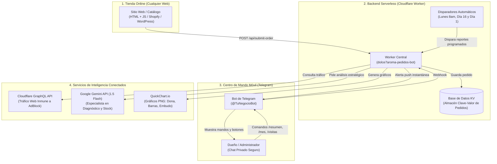

# 🏛️ BLUEPRINT DE IMPLEMENTACIÓN Y REPLICACIÓN
## Ecosistema E-Commerce con Cloudflare Workers, KV, Telegram Bot, Analytics GraphQL y Gemini IA

> **Propósito:** Esta guía permite a cualquier desarrollador o dueño de negocio clonar e implementar en otra página web el mismo sistema de reportería, control de caja, medición de tráfico en tiempo real y asesoría con Inteligencia Artificial.
> **Costo de Operación:** **$0.00 / mes** (Opera 100% sobre los planes gratuitos de Cloudflare, Telegram Bot API, QuickChart y Google Gemini).

---

## 1. Arquitectura General del Sistema



---

## 2. Requisitos Previos & Cuentas Necesarias

Para replicar este sistema en una nueva web, solo se necesitan 4 cuentas gratuitas:
1. **Cuenta en Cloudflare** ([dash.cloudflare.com](https://dash.cloudflare.com)): El dominio de la nueva web debe estar delegado en Cloudflare (gestión DNS).
2. **Cuenta de Telegram:** Para crear el bot con `@BotFather` y obtener el `TELEGRAM_BOT_TOKEN`.
3. **ID de Chat de Telegram:** Para restringir el acceso exclusivo al dueño (se obtiene hablando con `@userinfobot`).
4. **Google AI Studio** ([aistudio.google.com](https://aistudio.google.com)): Para obtener una `GEMINI_API_KEY` gratuita.

---

## 3. Guía Paso a Paso de Configuración

### Paso 1: Crear el Bot en Telegram
1. Abre Telegram y busca al usuario oficial **`@BotFather`**.
2. Envía el comando `/newbot`.
3. Asigna un nombre al bot (ej: *Mi Tienda Bot*) y un usuario que termine en `bot` (ej: *mitienda_pedidos_bot*).
4. Copia el **HTTP API Token** generado (ej: `78234821:AAFn9...`).
5. Abre el bot **`@userinfobot`** en Telegram para conocer tu **ID numérico personal** (ej: `8616800327`). Solo tú podrás darle órdenes al bot.

---

### Paso 2: Crear los Secretos en Cloudflare
1. Entra a **[dash.cloudflare.com](https://dash.cloudflare.com)** ➔ Ve a tu dominio ➔ En la columna derecha copia tu **Zone ID** (32 caracteres).
2. Ve a **[dash.cloudflare.com/profile/api-tokens](https://dash.cloudflare.com/profile/api-tokens)** ➔ **Crear token** (*Create Token*).
3. Agrega estos permisos mínimos:
   * **Zona** ➔ **Análisis** (*Analytics*) ➔ **Lectura** (*Read*).
   * **Trabajadores** (*Workers Scripts*) ➔ **Edición** (*Edit*).
4. En Recursos de Zona: Selecciona **Incluir** ➔ **Zona específica** ➔ Tu nuevo dominio.
5. Guarda y copia el token generado (`CF_API_TOKEN`).

---

### Paso 3: Configurar el archivo `wrangler.toml`

En el proyecto del nuevo sitio web, crea o ajusta `wrangler.toml`:

```toml
name = "nombre-de-tu-worker-bot"
main = "worker/admin-worker.js"
compatibility_date = "2024-11-01"

[[kv_namespaces]]
binding = "ORDERS"
id = "PEGAR_AQUI_EL_ID_DEL_KV_NAMESPACE"

[vars]
ORDER_EMAIL_TO = "contacto@tunegocio.com"
TELEGRAM_CHAT_ID = "TU_ID_NUMERICO_TELEGRAM"
CF_ZONE_ID = "TU_ZONE_ID_DE_CLOUDFLARE"

# Disparadores programados (Hora Perú / UTC -5)
[triggers]
crons = [
  "0 13 * * 1",   # Lunes 8:00 AM (Reporte Semanal)
  "0 11 16 * *",  # Día 16 6:00 AM (Auditoría CRO y Embudos)
  "0 11 1 * *"    # Día 1 6:00 AM (Reporte Mensual Ejecutivo)
]
```

Carga los secretos cifrados desde la consola:
```powershell
npx wrangler secret put TELEGRAM_BOT_TOKEN
npx wrangler secret put CF_API_TOKEN
npx wrangler secret put GEMINI_API_KEY
```

---

### Paso 4: Enlazar el Webhook del Bot a Cloudflare
Una vez desplegado tu Worker con `npx wrangler deploy`, Cloudflare te dará una URL (ej: `https://nombre-de-tu-worker-bot.workers.dev`).

Para que Telegram le envíe los mensajes a tu Worker, abre tu navegador y visita esta URL (reemplazando tu token y tu URL):
```text
https://api.telegram.org/bot<TU_TELEGRAM_BOT_TOKEN>/setWebhook?url=https://<TU_WORKER_URL>/api/telegram-webhook
```
Debe responder: `{"ok":true,"result":true,"description":"Webhook was set"}`.

---

## 4. Estructura Oficial de Comandos del Bot

El bot implementa un menú ordenado en 4 categorías de alto valor:

```text
🌸 [NOMBRE NEGOCIO] — PANEL DE CONTROL 🌸
Gestión Comercial y Operativa

📦 PEDIDOS & CAJA (Operación Diaria):
• /resumen — Caja del día y balance en soles (📅 Uso: Cada noche al cerrar).
• /pedidos — Pedidos pendientes con botón a WhatsApp (📅 Uso: Tiempo real).
• /pagado [ID] — Confirmar cobro y descontar stock (📅 Uso: Al validar pago).
• /cancelar [ID] — Cancelar pedido no concretado.

🏷️ MOSTRADOR & CONSULTA RÁPIDA:
• /precios [producto] — Stock y precios al instante (📅 Uso: Con cliente al frente).

📊 ESTRATEGIA & CRECIMIENTO (Rutina de Negocio):
• /semana — Rendimiento semanal y gráfico (📅 Uso: Lunes 8:00 AM).
• /cro — Embudo de conversión y abandonos (📅 Uso: Día 16 de cada mes).
• /mes — Facturación, tráfico web y donas (📅 Uso: Día 1 de cada mes).
• /top — Ranking de los 5 productos más vendidos.
• /campana — Reloj comercial y planificador de fechas (📅 Uso: Pre-campañas).

🌐 TRÁFICO WEB & DEMANDA (Auditoría de Clientes):
• /visitas — Tráfico real en Cloudflare (📅 Uso: Diario o interdiario).
• /demanda — Radiografía de público, intención y aromas (📅 Uso: Viernes y sábados).
• /seo — Indexación en Google y distritos (📅 Uso: Quincenal).
```

---

## 5. El Reporte Mensual Consolidado (`/mes`)

El comando estrella une **Finanzas (KV)**, **Tráfico Real (Cloudflare)** e **Inteligencia Artificial (Gemini)**:

1. **Foto con Gráfico de Dona (QuickChart API):**
   * Gráfico comparativo de categorías (ej. Línea A vs Línea B).
2. **Pie de Foto Estructurado:**
   * **Bloque 1 (Finanzas):** Facturación total, pedidos cobrados, ticket promedio y comparativa MoM.
   * **Bloque 2 (Tráfico & Conversión Cloudflare):** Cantidad de personas que navegaron en la web y Tasa de Conversión Oficial:
     $$\text{Tasa de Conversión} = \left(\frac{\text{Pedidos Cobrados}}{\text{Visitantes Únicos Cloudflare}}\right) \times 100$$
   * **Ranking:** Top 5 productos más vendidos.
3. **Mensaje de la IA (Gemini 1.5 Flash):**
   * Diagnóstico del mes en 2 frases contundentes.
   * Plan de compras y abastecimiento de stock para el siguiente mes.
   * 2 acciones inmediatas para WhatsApp y el punto físico.

---

## 6. Checklist de Adaptación para un Nuevo Proyecto

Para llevar este sistema a otra página web, únicamente debes reemplazar:
* [ ] **Nombre del Worker:** en `wrangler.toml` (línea 1).
* [ ] **KV Namespace:** crear uno nuevo con `npx wrangler kv namespace create ORDERS`.
* [ ] **Zone ID:** el identificador del nuevo dominio en Cloudflare.
* [ ] **Catálogo / Productos:** el archivo JSON o base de datos de productos de la nueva web.
* [ ] **Chat ID:** el ID del dueño de la nueva página.
* [ ] **Tokens:** `TELEGRAM_BOT_TOKEN`, `CF_API_TOKEN` y `GEMINI_API_KEY`.
