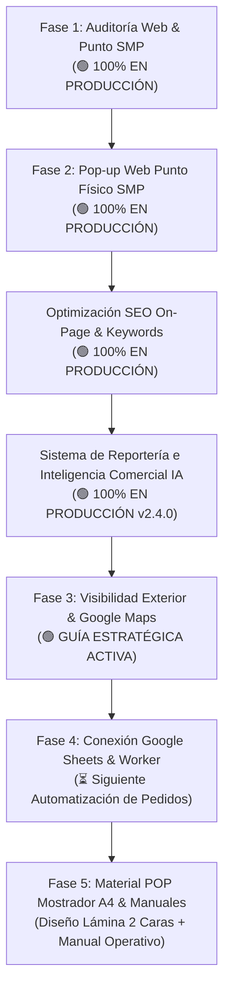

# 📋 Reporte de Auditoría y Plan Estratégico — Dolce 7 Aroma
**Fecha de corte:** 7 de noviembre de 2026  
**Versión del informe:** 2.4 (Fase 3: Visibilidad Local, Ficha Google Maps & Letrero Exterior)  
**Ecosistema:** GitHub Pages (Frontend) + Cloudflare Workers / KV (Backend) + Dominio `dolce7aroma.com`

---

## 1. Resumen Ejecutivo del Estado del Sistema

El ecosistema digital de **Dolce 7 Aroma** ha completado el despliegue del Sistema de Inteligencia Comercial y Reportería IA (v2.4.0) y la optimización SEO On-Page en la web. Ahora se activa la **Fase 3: Visibilidad Exterior y Posicionamiento Local en Google Maps** para convertir el flujo peatonal de San Martín de Porres y las búsquedas locales de Lima Norte en ventas presenciales y recojos en tienda.

### 🌐 Estado en Producción (`https://dolce7aroma.com/`):
* **Sistema de Reportería IA & Bot de Telegram:** 100% activo en producción con 7 comandos y 3 crons programados.
* **SEO On-Page & Palabras Clave:** Metadatos optimizados en `index.html` y `catalogo.html` con términos de alta conversión (*delivery gratis*, *dupes*, *perfumes contratipo*, *SMP*).
* **Punto Físico Integrado en Web:** Pestañas boutique duales, aviso modal interactivo y opción de recojo en tienda gratuita sin monto mínimo activas.
* **Sitemap XML & Robots.txt:** Actualizados y validados por el bot de auditoría técnica.

---

## 2. Hoja de Ruta Consolidada



---

## 3. Plan de Ejecución: Fase 3 — Visibilidad Exterior y Google Maps

### 📍 A. Ficha Estratégica en Google Business Profile (Google Maps)

Para aparecer en los primeros 3 resultados de Google cuando alguien busque en su celular *"perfumes cerca de mí"*, *"perfumeria smp"* o *"dupes en lima norte"*:

#### 1. Datos Clave de Registro:
* **Nombre Comercial Optimizado (Google Business Name):**  
  `Dolce 7 Aroma - Perfumes Dupes & Fragancias Árabes | SMP`
* **Categoría Principal:**  
  `Perfumería` (*Perfume store*)
* **Categorías Secundarias:**  
  `Tienda de regalos` (*Gift shop*), `Tienda de cosméticos y belleza` (*Beauty supply store*).
* **Dirección Física Exacta:**  
  `Jr. Callao 482-A, San Martín de Porres 15001, Lima, Perú`  
  *(Añadir indicación: "Ubicado dentro de Bazar Sport Shirley, a pocas cuadras de Av. Perú").*
* **Teléfono Comercial:** WhatsApp oficial de pedidos.
* **Sitio Web con UTM de Rastreo:**  
  `https://dolce7aroma.com/?utm_source=google_maps&utm_medium=local_pack&utm_campaign=ficha_smp`

#### 2. Descripción Comercial Optimizada (Copy de 750 caracteres):
```text
Dolce 7 Aroma es tu perfumería de confianza en San Martín de Porres (Lima Norte). Especialistas en fragancias contratipo de alta fijación, dupes macerados de diseñador y exclusiva perfumería árabe (Lattafa, Afnan, Orientica). 

✨ Presentaciones para cada necesidad:
• Frascos Pocket de 10 ml a solo S/ 20 (¡el regalo perfecto!).
• Frascos macerados de 50 ml y 110 ml de larga duración (8-12 hrs).

📍 Encuéntranos dentro de Bazar Sport Shirley en Jr. Callao 482-A, SMP. 
🎁 ¡Ven a conocer nuestro catálogo y llévate un probador de 0.5 ml de cortesía con tu visita!
🚚 Delivery gratis en Lima y recojo inmediato sin costo en tienda. Aceptamos Yape, Plin y tarjetas.
```

#### 3. Catálogo de Productos a Cargar en Google Maps:
1. **Perfumes Pocket 10 ml** — Precio: S/ 20.00 | Categoría: Fragancias de bolsillo.
2. **Perfumes Macerados 50 ml** — Precio: S/ 55.00 - S/ 60.00 | Categoría: Uso diario.
3. **Perfumes Macerados 110 ml** — Precio: S/ 90.00 - S/ 95.00 | Categoría: Presentación prémium.
4. **Perfumería Árabe Macerada** — Precio: Desde S/ 20.00 | Categoría: Fragancias orientales.

#### 4. Preguntas y Respuestas Automatizadas (Google Q&A):
* **P:** *¿Tienen probadores para oler las fragancias antes de comprar?*  
  **R:** ¡Sí! En nuestro punto de Jr. Callao 482-A puedes probar todos los aromas de diseñador y árabes antes de decidirte.
* **P:** *¿Cuál es el horario de atención?*  
  **R:** Lunes a Sábado de 10:00 AM a 8:30 PM. Domingos previa coordinación por WhatsApp.

---

### 🎨 B. Especificaciones del Letrero Desmontable Exterior

Para detener a los transeúntes de Jr. Callao y canalizarlos hacia el interior del bazar:

#### 1. Formatos Recomendados:
* **Opción 1 (Más Versátil): Caballete Tipo "A" (Tijera):**  
  * Medidas: 60 cm de ancho x 90 cm de alto.
  * Material: Estructura metálica liviana o madera con paneles de lona blackout o PVC impermeable. Fácil de sacar en la mañana y guardar al cierre.
* **Opción 2: Panel Colgante Desmontable:**  
  * Medidas: 50 cm x 70 cm con 4 ojales metálicos para enganchar con mosquetones o ganchos "S" a la reja exterior del bazar.

#### 2. Jerarquía Visual y Distribución del Diseño:
* **Cabecera (25% superior):**  
  * Fondo: Negro mate o Rosa rubor (#fdf2f4).
  * Elemento: Isotipo de gota/flor en dorado metalizado + Tipografía elegante: **DOLCE 7 AROMA**.
* **Cuerpo Principal (50% central — El Gancho):**  
  * Texto grande de alto contraste (blanco sobre negro o negro sobre blanco):  
    `PERFUMES DE ALTA FIJACIÓN`  
    `DUPES DE DISEÑADOR & PERFUMES ÁRABES`
  * Pastilla destacada en dorado/amarillo:  
    `FRASCOS POCKET 10ml · S/ 20.00`  
    `¡Pruébalos gratis aquí adentro!`
* **Pie Inferior (25% base — Cierre y Acción):**  
  * Código QR grande de alta legibilidad con leyenda:  
    *"Escanea para ver catálogo completo en tu celular"* (vincula a `https://dolce7aroma.com/catalogo.html`).
  * Iconos visibles: Logo de WhatsApp con número + Logo de Yape/Plin + *"Recojo Express"*.

---

### 💬 C. Plantilla de Fidelización y Reseñas en Google Maps

El factor número 1 para subir al puesto 1 en Google Maps son las opiniones con 5 estrellas de clientes locales. 

**Mensaje para enviar por WhatsApp tras una compra o recojo:**
```text
¡Hola [Nombre]! 🌸 Muchas gracias por visitarnos hoy en nuestro punto de Jr. Callao 482-A.

¿Podrías regalarnos 1 minutito dejándonos una calificación en Google Maps? Nos ayuda muchísimo a que más vecinos de San Martín de Porres conozcan la perfumería:
👉 [ENLACE CORTO DE RESEÑA DE GOOGLE]

🎁 ¡Guarda tu captura! En tu siguiente compra te regalaremos un decant extra de 0.5 ml de tu aroma favorito. ¡Que disfrutes tu perfume! ✨
```

---

## 4. Próxima Fase: Fase 4 — Automatización de Pedidos en Google Sheets
* Conexión directa del endpoint `/api/submit-order` del Cloudflare Worker para insertar cada pedido en una hoja de cálculo en Google Drive en tiempo real, registrando: ID de pedido, Fecha/Hora, Nombre, Teléfono, Distrito, Productos, Total, Método de Pago y Estado.
