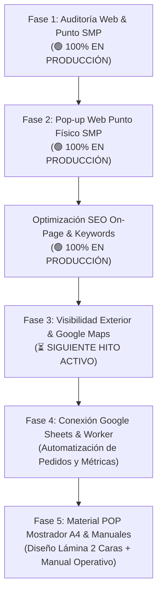

# 📋 Reporte de Auditoría y Plan Estratégico — Dolce 7 Aroma
**Fecha de corte:** 7 de noviembre de 2026  
**Versión del informe:** 2.3 (SEO On-Page & Delivery Gratis Desplegado)  
**Ecosistema:** GitHub Pages (Frontend) + Cloudflare Workers / KV (Backend) + Dominio `dolce7aroma.com`

---

## 1. Resumen Ejecutivo del Estado del Sistema

El ecosistema digital de **Dolce 7 Aroma** ha completado el despliegue en producción de las mejoras SEO On-Page y palabras clave estratégicas para maximizar el posicionamiento antes del lanzamiento de la Fase 3 en Google Maps.

### 🌐 Estado en Producción (`https://dolce7aroma.com/`):
* **SEO On-Page & Palabras Clave:** `<title>`, `<meta description>` y `<meta keywords>` actualizados en `index.html` y `catalogo.html`, posicionando los términos *"delivery gratis en Lima"*, *"perfumes contratipo"*, *"dupes"* y *"Jr. Callao 482-A, SMP"*.
* **Micro-ajustes de Encabezado `H1`:** Cintillo superior (`eyebrow`) y texto descriptivo inmediatamente adyacente al `H1` reforzados con la propuesta de valor comercial y ubicación física.
* **Sitemap XML Actualizado:** Fechas `<lastmod>` refrescadas a `2026-11-07` para forzar el rastreo inmediato de Google.
* **Kit de Marketing (`docs/4_MARKETING_Y_SEO.md`):** Glosario completo de keywords dividido por intención de búsqueda (Local, Delivery/Precios, Contratipos/Dupes).
* **Fases 1 y 2 Activas en Vivo:** Boutique con pestañas duales, regla de recojo en SMP < S/ 50 y Pop-up modal de bienvenida.

---

## 2. Hoja de Ruta Consolidada

---

## 3. Próximo Paso: Fase 3 — Visibilidad Exterior y Google Maps
1. **Ficha en Google Business Profile / Google Maps:**
   * Registro con categorías clave (Perfumería, Regalos, Ropa) y palabras clave locales ya sincronizadas con la web.
2. **Letrero Desmontable Exterior:**
   * Diseño y medidas para colocar en la fachada del bazar de Jr. Callao 482-A.
