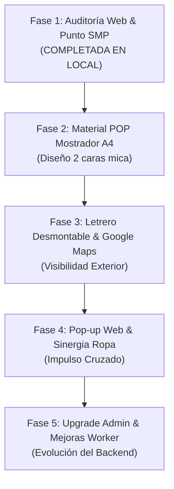

# 📋 Reporte de Auditoría y Estado Técnico — Dolce 7 Aroma
**Fecha de corte:** 7 de noviembre de 2026  
**Versión del informe:** 1.3  
**Ecosistema:** GitHub Pages (Frontend) + Cloudflare Workers / KV (Backend) + Dominio `dolce7aroma.com`

---

## 1. Resumen Ejecutivo del Estado del Sistema

El proyecto **Dolce 7 Aroma** se encuentra desplegado y operativo en producción bajo un esquema *Headless* desacoplado.

### Diagnóstico de Infraestructura y Servicios (Cloudflare Worker):
* **Estado del Worker:** **Activo y saludable.** En las métricas recientes de Cloudflare registra 0 errores y tiempo de CPU óptimo (~433 µs).
* **Secreto `ADMIN_KEY`:** Actualizado con éxito a la nueva clave en producción.
* **Base de datos KV:** Enlazado a `ORDERS` (`dolce-aroma-pedidos`) funcionando con normalidad.

---

## 2. Matriz de Seguimiento de Tareas y Pendientes

| Código | Tarea / Hallazgo | Área | Prioridad | Estado | Impacto Operativo |
| :--- | :--- | :--- | :---: | :---: | :--- |
| **AUD-01** | **Riesgo en Admin (`SEED_URL`):** Carga de datos y exportación en Admin. | Backend / Admin | 🔴 Alta | 🟢 Resuelto | `SEED_URL` apunta a `data/productos.json` con fallback. Exportación fijada en `productos.json`. Catálogo sincronizado en 66 perfumes. |
| **AUD-Local** | **Punto Físico SMP en la Web:** Boutique con pestañas compartidas y Checkout sin fricción. | Frontend / UX | 🔴 Alta | 🟢 Resuelto | Ventana compartida con pestañas (Ver Mapa / Aromas en Tienda), botón Google Maps directo, y para compras < S/ 50 se desactivaron los campos de dirección/referencia y se ocultó la tarjeta de delivery. |
| **AUD-02** | **Pasarela Culqi:** Integración en código pero inactiva en producción. | Pagos / Checkout | 🟡 Media | 🛑 En pausa | La web muestra "Próximamente" para tarjeta; opera con Yape/Plin y Transferencia. |
| **AUD-03** | **Seguimiento Automático de Regalos:** Falta Cron Trigger en Cloudflare. | Workers / Cron | 🔵 Baja | 📋 Backlog | Regalos vencen a los 15 días por consulta pasiva; falta aviso automático push al comprador. |
| **AUD-04** | **Banners de Hero:** `data/anuncios-hero.json` sin campañas registradas. | Marketing / Admin | 🟡 Media | ⏳ Pendiente | Carrusel principal rota solo perfumes destacados; pendiente subir ofertas de temporada. |
| **AUD-05** | **Propuesta de Rediseño (`propuesta_stitch.html`):** Boceto Tailwind/Garamond. | Frontend / UX | 🔵 Baja | 💡 Evaluación | Evaluación para rediseño editorial futuro o archivo. |
| **AUD-06** | **Zonas de Envíos:** Tarifa y cobertura en Lima Metropolitana y Provincias. | Logística / Datos | 🟡 Media | ⏳ Pendiente | Configurado recojo gratis en SMP; compras >= S/ 50 tienen delivery habilitado. |
| **AUD-07** | **Actualización de Sitemap:** Refrescar fechas `lastmod`. | SEO Técnico | 🟢 Baja | ⏳ Pendiente | Actualizar fecha tras mejoras de noviembre en multimedia y catálogo. |

---

## 3. Hoja de Ruta Consolidada

### Fase 1: Auditoría Web Inmediata (✅ Completada en Local)
1. **Sección Boutique con Ventana Compartida (`index.html`):**
   * Pestaña 1: **Ver Mapa** (iframe de Google Maps enfocado en Jr. Callao 482-A).
   * Pestaña 2: **Aromas en Tienda** (14 aromas de tus láminas A4: 7 Dama / 7 Caballero con precios y sensaciones olfativas).
   * Columna izquierda compacta: información de tienda, recojo en 5 a 10 hrs y botón Google Maps directo.
2. **Checkout Inteligente de Recojo en Tienda (`shop.js`):**
   * Para pedidos menores a S/ 50.00: se eliminan los campos de dirección y referencia, se oculta la tarjeta de delivery y solo se solicita Nombre y Teléfono.
   * Para pedidos iguales o mayores a S/ 50.00: se desbloquea el formulario completo con delivery a domicilio.
3. **SEO Local Estructurado (`Schema.org`):**
   * Coordenadas exactas y enlace de mapa integrados.

### Fase 2: Material POP Físico para Mostrador (⏳ Próximo Paso)
* Maquetación para la lámina A4 de doble cara del pedestal acrílico.

### Fase 3: Visibilidad Exterior & Google Maps (📋 Planificado)
* Letrero desmontable y ficha oficial en Google Maps / Business Profile.

### Fase 4: Sinergia de Ropa & Pop-up Web (📋 Planificado)
* Pop-up de inicio y catálogo de prendas del bazar de la prima.

### Fase 5: Upgrade de Panel Admin & Optimizaciones del Worker (📋 Planificado)
* Interconexión avanzada del Admin y bot interactivo de Telegram.
