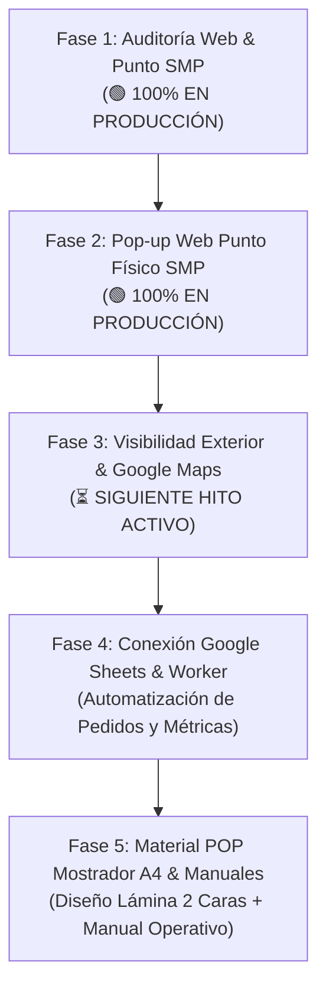

# 📋 Reporte de Auditoría y Plan Estratégico — Dolce 7 Aroma
**Fecha de corte:** 7 de noviembre de 2026  
**Versión del informe:** 2.2 (Fase 2 Desplegada en Producción)  
**Ecosistema:** GitHub Pages (Frontend) + Cloudflare Workers / KV (Backend) + Dominio `dolce7aroma.com`

---

## 1. Resumen Ejecutivo del Estado del Sistema

El ecosistema digital de **Dolce 7 Aroma** ha completado y desplegado exitosamente las **Fases 1 y 2** de su plan de consolidación web y punto físico de venta en San Martín de Porres.

### 🌐 Estado en Producción (`https://dolce7aroma.com/`):
* **Pop-up Web Punto Físico SMP (Fase 2):** Modal interactivo nativo (HTML/CSS/JS) activo en producción. Aparece a los 2.5s con control de sesión (`sessionStorage`), informando sobre el local en Jr. Callao 482-A, frascos de 10 ml a S/ 20, recojo gratuito y muestra de regalo por compra de ropa en el bazar. Cuenta con botón de desplazamiento suave hacia la sección Boutique activando la pestaña de aromas.
* **Boutique Física SMP (`index.html`):** Pestañas interactivas compartidas (`🗺️ Ver Mapa` y `🌸 Aromas en Tienda`) con catálogo físico y enlace directo de GPS a Jr. Callao 482.
* **Checkout Inteligente (`assets/shop.js`):** Regla comercial de S/ 50 en vivo (recojo sin fricción para compras menores; delivery a domicilio desbloqueado para montos $\ge$ S/ 50).
* **Multimedia de Marca:** Video de Filosofía en reproducción completa y bucle suave continuo.
* **Panel de Administración (`perfumes-gestion-da7.html`):** Hash SHA-256 actualizado (`SoaD.2027`) y sincronizado con 66 perfumes en `productos.json`.
* **Backend Cloudflare:** Worker activo (`dolce7aroma-pedidos-bot`) enlazado a KV `ORDERS` con 0 errores y reportería interactiva (Hitos 1 y 2).

---

## 2. Matriz de Seguimiento de Tareas y Entregables

| Código | Tarea / Entregable | Área | Prioridad | Estado | Impacto Operativo |
| :--- | :--- | :--- | :---: | :---: | :--- |
| **AUD-01** | **Riesgo en Admin (`SEED_URL`):** Carga y exportación desincronizada. | Backend / Admin | 🔴 Alta | 🟢 Desplegado | Resuelto. `SEED_URL` y exportación apuntan a `productos.json` (66 perfumes). |
| **AUD-Local** | **Punto Físico SMP en la Web:** Boutique con pestañas duales y Checkout sin fricción. | Frontend / UX | 🔴 Alta | 🟢 Desplegado | En vivo en producción. Menos de S/ 50 = recojo en tienda sin datos de dirección innecesarios. |
| **AUD-Video** | **Video Filosofía en Bucle:** Extracción de límite forzado de 6s. | Multimedia / UX | 🟡 Media | 🟢 Desplegado | Video nuevo de 6.3MB reproduce completo y en bucle continuo. |
| **AUD-Pass** | **Actualización Credencial Admin:** Clave de acceso administrativa. | Seguridad | 🔴 Alta | 🟢 Desplegado | Hash SHA-256 actualizado en código (`SoaD.2027`). |
| **AUD-Popup** | **Pop-up Web Punto SMP:** Anuncio interactivo del punto físico y recojo. | Frontend / CRO | 🔴 Alta | 🟢 Desplegado | Activo en producción con retardo de 2.5s, control de frecuencia y enlace a Boutique. |
| **AUD-Maps** | **Ficha Google Business / Maps:** Registro y posicionamiento local. | Marketing / SEO | 🔴 Alta | ⏳ Siguiente Hito | Alta en Google Maps para búsquedas locales en SMP (Bazar Sport Shirley / Dolce Aroma). |
| **AUD-Letrero**| **Letrero Desmontable Exterior:** Cartel visual para fachada. | Punto Físico / Venta | 🟡 Media | ⏳ Siguiente Hito | Diseño y especificaciones para letrero colgante desmontable. |
| **AUD-Sheets**| **Conexión Google Sheets:** Registro automático de pedidos y métricas. | Backend / Datos | 🟡 Media | 📋 Planificado | Webhook del Worker hacia Google Sheets para contabilidad y análisis sin costo. |
| **AUD-POP** | **Material POP para Mostrador A4:** Lámina 2 caras para pedestal acrílico. | Punto Físico / Venta | 🟡 Media | 📋 Planificado | Carta de aromas + Cartel de cobro con Yape/Plin y gancho de ropa. |
| **AUD-02** | **Pasarela Culqi:** Pago con tarjeta de crédito/débito. | Pagos / Checkout | 🟡 Media | 🛑 En pausa | La web opera con Yape/Plin y transferencias; pasarela retenida temporalmente. |
| **AUD-03** | **Vencimiento de Regalos:** Alerta push de caducidad a los 15 días. | Workers / Cron | 🔵 Baja | 📋 Backlog | Regalos vencen pasivamente; falta Cron Trigger para recordatorio proactivo. |

---

## 3. Hoja de Ruta Consolidada

---

## 4. Detalle de las Siguientes Fases

### 📍 Fase 3: Visibilidad Exterior y Google Maps (Próximo Hito a Iniciar)
1. **Ficha en Google Business Profile / Google Maps:**
   * Registro del punto físico bajo nombre estratégico (ej. *Dolce Aroma Perfumes — Punto SMP (Bazar Shirley)* o asociarlo a la ubicación comercial).
   * Categorías clave: Perfumería, Tienda de Regalos, Tienda de Ropa.
   * Carga de fotos de perfumes, frascos pocket y fachada.
2. **Letrero Desmontable Exterior:**
   * Medidas recomendadas y estructura liviana (ganchos o base portátil) que tu prima pueda sacar y entrar fácilmente todos los días.
   * Contraste visual de alto impacto (logotipo Dolce Aroma en negro/dorado sobre fondo claro, texto visible a distancia).

---

### 📊 Fase 4: Conexión Google Sheets & Métricas
* Webhook en Cloudflare Worker para volcar cada pedido confirmado y métricas del bot en tiempo real en una hoja de Google Sheets.

---

### 🎨 Fase 5: Material POP A4 (Mostrador de Mica) & Manual Operativo
* Maquetación para impresión de la lámina A4 doble cara (Carta de aromas / Cartel Yape + gancho de probador de 0.5 ml).
* Actualización final del manual operativo del negocio (`docs/3_MANUAL_OPERATIVO.md`).
